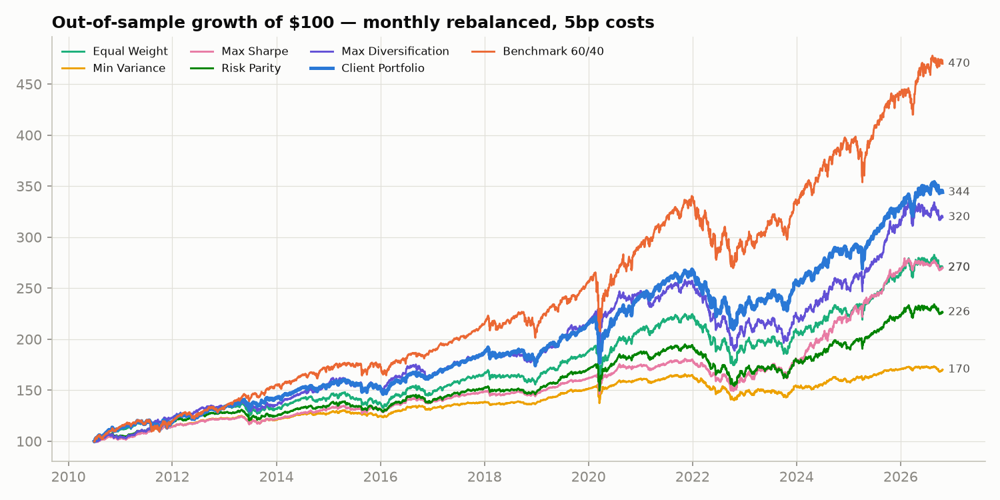
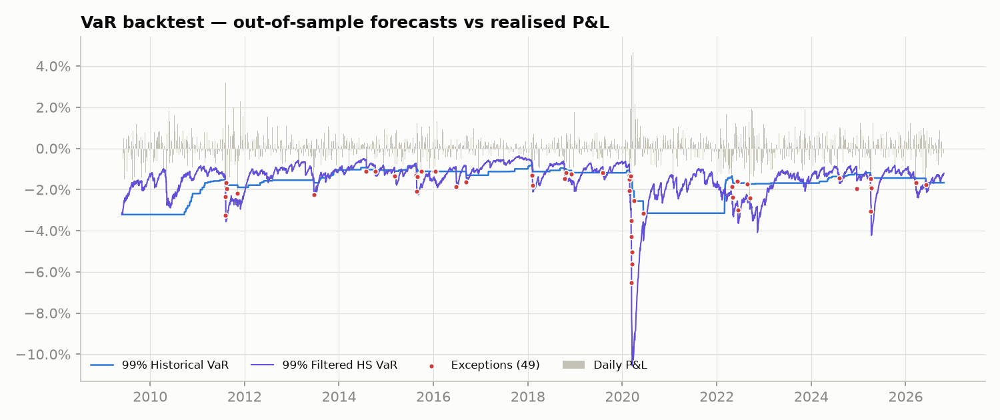
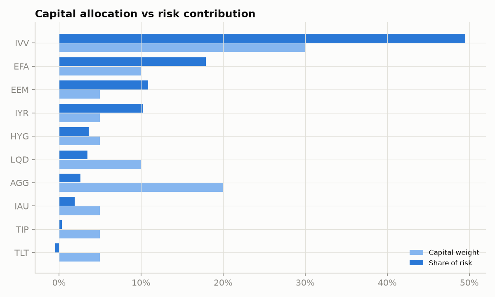
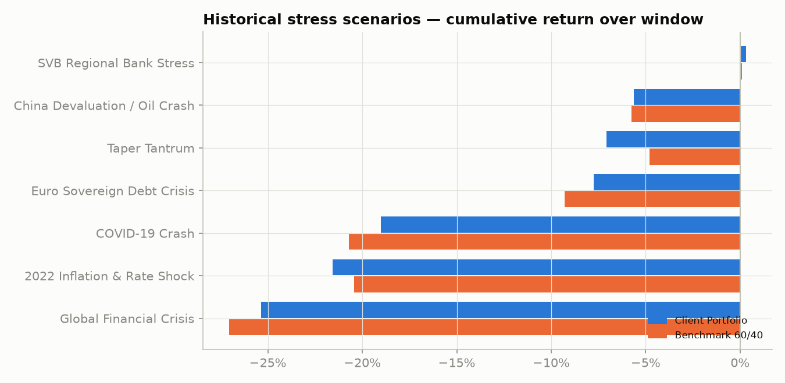
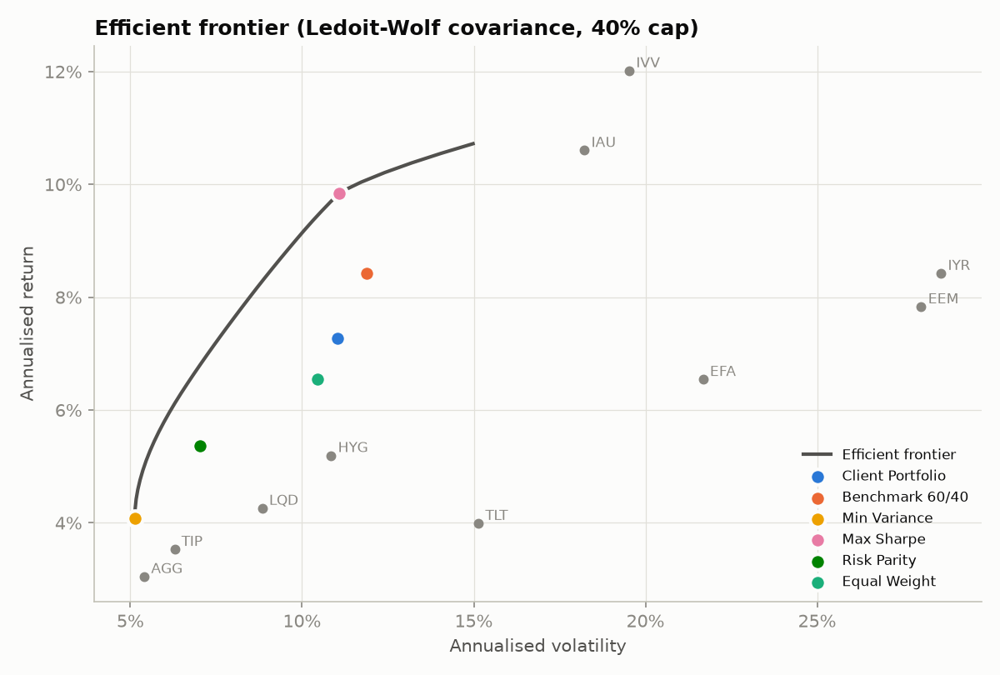
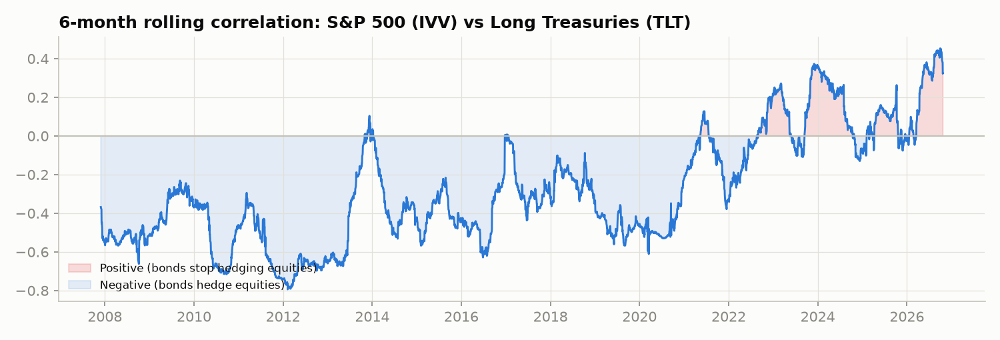

# Multi-Asset Portfolio Risk Analytics Engine

An end-to-end risk and performance analytics platform for a **$100M multi-asset portfolio
of iShares ETFs**: a compact, open-source take on the workflows inside an institutional
risk system like BlackRock's Aladdin.

It ingests **19 years of daily market data (2007–2026, 4,880 trading days)** into a SQL
warehouse. From there it measures VaR and Expected Shortfall four ways and
**statistically backtests** those models. It also decomposes risk by asset and by
Fama-French factor, stress-tests the portfolio against 7 historical crises and 6
hypothetical shocks, and compares 5 portfolio-construction strategies **out of sample**.
The results are delivered as an interactive dashboard and an HTML risk report.

`Python` · `SQL (SQLite)` · `pandas` · `NumPy` · `SciPy` · `statsmodels` · `Plotly` · `Streamlit` · `pytest`



---

## Key findings

| # | Finding | Evidence |
|---|---|---|
| 1 | **A "diversified" portfolio still carries mostly equity risk.** Equities are 45% of capital but **78% of portfolio volatility**, or 88% once REITs are included. | Euler risk decomposition |
| 2 | **Market beta explains 86% of portfolio variance.** Size, value, profitability and investment factors add almost nothing, and alpha is statistically zero (t = 0.17). | Fama-French 5 + Momentum regression, Newey-West SEs |
| 3 | **Normal-distribution VaR understates tail risk.** Returns show excess kurtosis of 13. Parametric VaR breached **73 times vs 44 expected** (Kupiec p < 0.001). | VaR backtest, 4,380 out-of-sample days |
| 4 | **VaR breaches cluster in crises.** Historical VaR gets the *count* right (49 vs 44, p = 0.44) but fails the independence test. Filtered Historical Simulation brings exceptions to 55 (p = 0.10) while staying responsive. | Kupiec and Christoffersen tests |
| 5 | **The stock-bond hedge broke in 2022.** IVV/TLT correlation went from **−0.70 (2011) to +0.30 (2026)**. In the 2022 rate shock the portfolio lost **−21.6%**, *more* than the 60/40 benchmark. | SQL correlation query, stress tests |
| 6 | **Rates shocks must use current correlations.** A +150bp shock calibrated on crisis-era data shows a false *gain*. Using the post-2022 regime it shows a **−5.5% loss ($5.5M)**. | Conditional-covariance scenarios |
| 7 | **International diversification cost return.** Brinson-Fachler attributes **−21pp of cumulative active return** to equity selection, because ex-US equities lagged the S&P 500. | Asset-class attribution vs 60/40 |
| 8 | **Optimization helps risk more than return.** Out of sample (2010–2026), Min Variance cut max drawdown to **−15.5%** (vs −22%), and Max Sharpe reached **Sharpe 0.78** (vs 0.71 for the client portfolio). Neither beat a US 60/40 in a decade dominated by US equities. | Walk-forward backtest with costs |

---

## What it does

### 1. Data engineering and SQL warehouse
- **Ingestion with a fallback chain**: `yfinance` → Yahoo chart API → synthetic generator
  (clearly flagged), so the pipeline never hard-fails. The Fama-French factors are parsed
  from Ken French's data library.
- **Star-schema SQLite warehouse**: `dim_asset`, `fact_price`, `fact_return`,
  `fact_factor`, `fact_portfolio_nav`.
- **9 analytical SQL queries** ([`sql/analytics.sql`](sql/analytics.sql)) use CTEs, window
  functions (`RANK`, `ROW_NUMBER`, running max, framed 63-day rolling volatility),
  compounding via `EXP(SUM(LN(1+r)))`, and Pearson correlation built from raw aggregates.
- **Data-quality checks** before results are published: missing rows, extreme moves, stale
  prices, duplicates and non-positive prices.

### 2. Value-at-Risk and Expected Shortfall
- **Four models**: historical simulation, parametric (normal), Cornish-Fisher (adjusted for
  skew and kurtosis), and **Monte Carlo with 100,000 multivariate Student-t scenarios**.
- Both **Expected Shortfall** (the Basel III / FRTB measure) and component VaR.
- **Backtesting**: rolling out-of-sample forecasts (no look-ahead) for Historical,
  Parametric, EWMA (RiskMetrics) and **Filtered Historical Simulation**, scored with the
  **Kupiec POF**, **Christoffersen independence** and conditional-coverage tests plus the
  **Basel traffic-light** zone.



### 3. Risk decomposition
- **Ledoit-Wolf shrinkage** covariance (implemented from the 2004 paper).
- **Euler decomposition** into marginal and total risk contributions, which sum exactly
  to portfolio volatility.



### 4. Factor model
- **Fama-French 5-factor + Momentum** regression with **Newey-West (HAC)** standard errors.
- Factor variance decomposition, return attribution and rolling 1-year exposures.

### 5. Stress testing
- **7 historical scenarios**: GFC 2008, Euro crisis 2011, Taper Tantrum 2013, China/Oil
  2015, COVID 2020, the 2022 rate shock and SVB 2023. Each one is reported as $ P&L and
  relative to the benchmark.
- **6 hypothetical scenarios** propagated through the **conditional multivariate-normal
  expectation** E[r_o | r_d = s] = μ_o + Σ_od Σ_dd⁻¹ (s − μ_d). Each scenario chooses a
  correlation regime: *stressed* (S&P down more than 10%) or *recent* (last 3 years).



### 6. Portfolio construction
- Min Variance, Max Sharpe (with return shrinkage), **Risk Parity / ERC** (convex
  log-barrier solver), Max Diversification and an efficient frontier, all with a 40%
  single-asset cap.
- **Walk-forward backtest**: monthly rebalancing on a trailing 3-year window, 5bp per side
  transaction costs, and turnover tracking.



### 7. Performance attribution
- **Brinson-Fachler** allocation, selection and interaction effects by asset class vs the
  60/40 benchmark.

### 8. Delivery
- **Interactive Streamlit dashboard** ([`app.py`](app.py)): build any portfolio with
  sliders and all analytics recompute live, including custom stress shocks and a live
  optimizer.
- **Self-contained HTML risk report** (`outputs/risk_report.html`) with KPI tiles and
  interactive charts.
- CSV exports of every result table (`outputs/`).



---

## Quick start

```bash
python -m venv .venv && source .venv/bin/activate
pip install -r requirements.txt

python run_pipeline.py          # fetch data → warehouse → analytics → report (~30s)
open outputs/risk_report.html   # the risk report
streamlit run app.py            # the interactive dashboard
pytest -q                       # 19 unit tests
```

## Project structure

```
portfolio-risk-analytics/
├── run_pipeline.py          # entry point: builds warehouse, runs analytics, writes outputs
├── app.py                   # Streamlit dashboard
├── riskengine/
│   ├── config.py            # universe, portfolio, benchmark, scenarios, parameters
│   ├── data.py              # market + factor data ingestion with fallbacks
│   ├── db.py                # SQLite schema, loaders, SQL runner
│   ├── metrics.py           # returns, Sharpe/Sortino/Calmar, drawdowns, beta, TE/IR
│   ├── var.py               # VaR/ES models, EWMA, FHS, Kupiec/Christoffersen backtests
│   ├── optimize.py          # Ledoit-Wolf, optimizers, frontier, walk-forward backtest
│   ├── factors.py           # Fama-French regression and rolling exposures
│   ├── attribution.py       # risk contributions, component VaR, Brinson-Fachler
│   ├── stress.py            # historical and conditional hypothetical stress tests
│   ├── pipeline.py          # orchestration
│   └── report.py            # charts and HTML report
├── sql/analytics.sql        # warehouse analytics queries
├── tests/                   # model validation tests (closed-form checks, no look-ahead)
└── docs/                    # chart images + interview guide
```

## Methodology notes and limitations
- **No look-ahead bias.** VaR forecasts use data up to t−1, and optimizers see only the
  trailing window. Both are enforced by unit tests.
- **Models were not tuned to pass backtests.** EWMA uses the RiskMetrics standard λ = 0.94.
- Cornish-Fisher VaR becomes unstable at very high kurtosis (13 here), which is a known
  limitation of the expansion. It shows here as a 99.5% VaR well above every other model.
- ETF adjusted close prices include dividends (total return). Fixed-income risk is
  modelled through ETF prices rather than duration or spread analytics.
- **Next steps**: rate and credit factors (DV01, OAS), GARCH-t VaR, liquidity-adjusted
  VaR, Black-Litterman expected returns, and scheduled runs (Airflow) feeding a BI tool.

## Resume bullets

- Built an end-to-end **Python/SQL risk analytics engine** for a $100M, 10-asset iShares
  ETF portfolio. It ingests 19 years of daily data into a star-schema SQLite warehouse
  with automated data-quality checks and 9 analytical SQL queries (CTEs, window functions).
- Implemented **4 VaR/Expected Shortfall models**, including 100K-scenario Student-t Monte
  Carlo, and **backtested 4,380 out-of-sample forecasts** with Kupiec and Christoffersen
  tests. Showed that normal VaR was breached 67% more often than expected and that Filtered Historical
  Simulation restored correct coverage.
- Decomposed portfolio risk with **Ledoit-Wolf covariance and Fama-French 5-factor
  regression** (R² = 86%). Found that equities were 45% of capital but 78% of risk.
  **Stress-tested** 13 historical and hypothetical scenarios, quantifying a $21.6M loss in
  a 2022-style rate shock.
- Compared 5 portfolio-construction strategies (risk parity, min variance, max Sharpe)
  in a **walk-forward backtest with transaction costs**. Min variance cut max drawdown
  from 22% to 15.5%. Results are delivered through an interactive **Streamlit dashboard**
  and an automated HTML risk report.

---
*Data: Yahoo Finance (ETF prices), Kenneth R. French Data Library (factors). For
educational and research purposes; not investment advice.*
